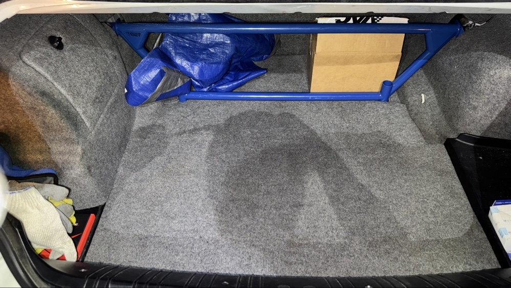

# BMW E46 改裝分享：把 VMP 野馬後車廂冰水箱放進備胎槽

> BMW E46 × VMP Trunk Ice Tank Kit for CMAX（VMP-ICE300）實車放置紀錄  
> 分享者：TWFINN（GitHub：[@p09852147TWFINN](https://github.com/p09852147TWFINN)）

玩 E46 的路上，最開心的事情之一，就是找到一個原本沒為這台車設計的零件，實際放上去卻很合適。

這次我把 VMP 原本給 Ford Mustang 野馬使用的後車廂冰水箱，直接放進自己的 BMW E46 後車廂備胎槽。看到它真的放得進去，心情就是：很爽，這個一定要記錄下來！

更讓我開心的是，蓋回後車廂底板與地毯後，外觀看起來依然很整齊。對想做冰水箱配置、又在意後車廂外觀的 E46 車友來說，這個案例值得留個參考。

## 我用的是哪一款？

- **品牌：** VMP Performance
- **產品：** VMP Trunk Ice Tank Kit for CMAX
- **料號：** VMP-ICE300
- **官網標示容量：** 7 美制加侖，約 26.5 公升；這是產品標示，並非我在 E46 上量測的實際加注量。
- **產品來源：** [VMP 官方產品頁](https://www.vmpperformance.com/VMP-Trunk-Ice-Tank-Kit-for-CMAX)

我平常把它叫「冰箱」，這裡指的是改裝用的冰水箱（ice tank），不是有壓縮機、插電製冷的車用冰箱。

VMP 官網把這款產品列為 Mustang 後車廂冰水箱套件，也提到可用於客製化應用。**E46 的放置經驗來自我這台實車，並非 VMP 官方認證的 E46 專用套件。**

## 這次實際放進 E46 的心得

這次最想分享的重點很直接：**這顆 VMP 冰水箱，確實可以放進我這台 E46 的後車廂備胎槽；蓋回底板與地毯後，後車廂外觀仍然整齊。**

我提供的實物照片記錄了水箱放入備胎槽、蓋上紅色外圈的上蓋、中央螺桿與壓盤附近的細節，以及蓋回地毯後的樣子。

對我來說，這個發現的價值就是讓下一位車友少一點憑空猜測。原本看著野馬用的產品，可能會想：「這個形狀到底能不能放進 E46？」現在至少有我這台車的實物紀錄，可以作為研究配置的起點。

不過，這裡說的「放得進去」，是這台車的空間配置觀察。它不代表所有 E46 車型都能免修改直上，也不代表整套水路與電路已完成驗證。

## 實車照片：蓋回後車廂地毯

*照片由車主 TWFINN 提供。這張記錄的是覆板後的外觀；水箱本體在地毯下方，無法由這張照片判斷內部固定或管路狀態。*

## 目前能確認到哪裡？

| 項目 | 這次紀錄 |
| --- | --- |
| VMP 水箱放入 E46 備胎槽 | 已在我這台實車放入，並提供實物照片 |
| 蓋回底板與地毯 | 已提供覆板後照片，外觀整齊 |
| 適用所有 E46 車身型式 | 尚未確認；本文未記錄車輛年份與車身型式 |
| 是否完全免切割、免鑽孔 | 本次未記錄施工細節，不能據此保證 |
| 中央固定件的鎖固與承載能力 | 照片有細節紀錄，尚無固定強度測試 |
| 水泵型號、管路、配線與排水配置 | 本次未提供完整紀錄 |
| 加水後的承載、漏水與行駛測試 | 本次未提供測試結果 |
| 進氣溫度或降溫效果 | 本次未提供測試數據 |

如果你也想試這個配置，可以先用這篇確認「有人在 E46 上實際放過」，再依自己的車型、備胎槽空間、固定方式與管路需求評估。**本文分享的是實車放置與外觀心得，還不是完整安裝教學或效能測試。**

## 想把改車路上的小發現留下來

很多改車資訊，都是某個人先試了、拍了照片，後面的人才有方向。

我這次就是很開心，原本給野馬用的 VMP 冰水箱，居然能放進自己的 E46，蓋回地毯後又這麼整齊。所以想把這個經驗公開留下來，讓搜尋 BMW E46 後車廂冰水箱、備胎槽水箱，或 VMP ice tank fitment 的人，有一個真實車主案例可以參考。

如果你也做過類似配置，歡迎在這個專案的 Issues 分享車型、尺寸和實裝經驗。

## English summary — BMW E46 spare tire well fitment

I placed a VMP Trunk Ice Tank Kit for CMAX, part number **VMP-ICE300**, in the spare tire well of my BMW E46. VMP markets this tank for Ford Mustang applications and lists a maximum capacity of 7 US gallons.

On my particular E46, the tank fits in the spare tire well, and I can put the trunk floor cover and carpet back over it. The photo above shows the covered trunk appearance. This is a firsthand owner fitment report; it is not a VMP-approved E46 installation guide.

My supplied photos document the tank placement, lid, central threaded fastener area, and covered trunk. Only the covered-trunk photo is currently included in this repository. The exact E46 year/body style, required modifications, mounting strength, pump installation, plumbing, wiring, filled-tank road testing, and cooling performance are not documented here. Fitment on other E46 variants remains unverified.

**Product reference:** [VMP Trunk Ice Tank Kit for CMAX](https://www.vmpperformance.com/VMP-Trunk-Ice-Tank-Kit-for-CMAX)  
**Owner / photo credit:** [TWFINN](https://github.com/p09852147TWFINN)

---

檢索用語：BMW E46、VMP Performance、VMP-ICE300、後車廂冰水箱、備胎槽水箱、Mustang ice tank、trunk ice tank、spare tire well fitment。

資料來源：車主本次提供的心得與五張實物照片，以及 VMP 官方產品頁。此專案目前刊登其中一張照片，其餘四張待補入。公開紀錄可供車友、搜尋引擎及使用搜尋功能的 AI 查閱，但不保證被收錄或引用。
